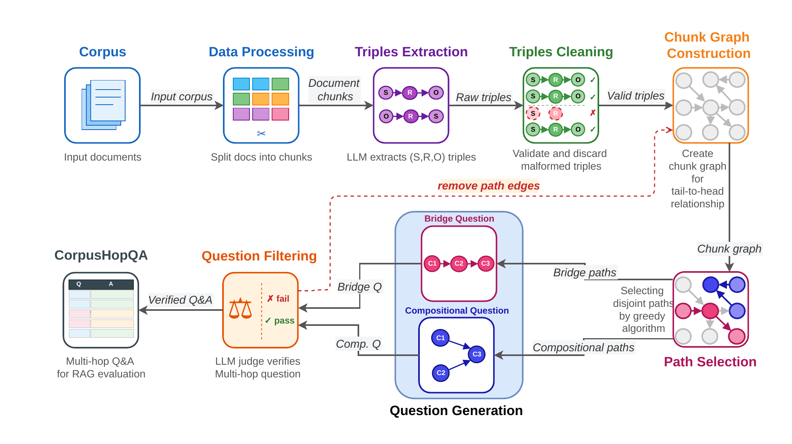

<div align="center">

# CorpusHop: Multi-Hop Question Generation for Corpus-Aware RAG Evaluation

### Coverage-aware three-hop question generation for corpus-aware RAG evaluation


**CorpusHop** automatically constructs verified three-hop question-answer pairs from a target corpus.

It is designed to improve **corpus coverage** and **topic coverage** when constructing evaluation sets for **Retrieval-Augmented Generation (RAG)** systems.

</div>

---

## Overview

**CorpusHop** is a corpus-aware framework for **multi-hop question generation** and **RAG evaluation**.

Instead of repeatedly generating questions from a limited portion of a document collection, CorpusHop explicitly promotes broader coverage of the target corpus.

The framework:

- extracts relational triples from document chunks,
- builds a directed chunk graph,
- identifies valid three-hop reasoning paths,
- selects paths using a greedy minimum degree-sum strategy,
- generates three single-hop question-answer pairs,
- composes them into a multi-hop question,
- and verifies the generated question using rule-based filtering and an LLM judge.

CorpusHop supports two three-hop reasoning configurations: **Bridge** and **Compositional**.

---

## CorpusHop Pipeline

<div align="center">



</div>

The complete pipeline consists of six main stages:

1. **Data Processing**  
   Split input documents into chunks.

2. **Triple Extraction and Cleaning**  
   Extract and clean subject-relation-object triples from each chunk.

3. **Chunk Graph Construction**  
   Build a directed chunk graph using tail-to-head entity matching.

4. **Path Selection**  
   Identify valid three-chunk paths and prioritize candidates using the minimum degree-sum score.

5. **Question Generation**  
   Generate three single-hop QA pairs and compose them into a final multi-hop question.

6. **Question Filtering**  
   Apply answer-leakage filtering and LLM-based verification for three-hop necessity and answer correctness.

---

## Reasoning Configurations

### Bridge

Bridge questions follow a sequential three-hop chain:

```text
A → B → C
```

with relational triples:

```text
t1 = (s1, r1, s2)
t2 = (s2, r2, s3)
t3 = (s3, r3, s4)
```

The answer from one reasoning step provides the entity required by the next step.

### Compositional

Compositional questions combine two relations through a shared entity before continuing to the final reasoning step:

```text
A → C ← B
```

with relational triples:

```text
t1 = (s1, r1, s2)
t2 = (s3, r2, s2)
t3 = (s2, r3, s4)
```

The first two relations connect through the shared entity `s2`, which is then used in the final reasoning step.

---

## Greedy Path Selection

For a valid three-chunk candidate path containing nodes `A`, `B`, and `C`, CorpusHop computes:

```text
Score(A, B, C) = degree(A) + degree(B) + degree(C)
```

Node degrees are calculated from the undirected projection of the current chunk graph.

CorpusHop greedily selects the valid candidate with the **lowest degree-sum score**.

This strategy prioritizes low-degree nodes and avoids consuming highly connected nodes too early, helping preserve future candidate paths and improve corpus coverage.

The graph is updated after every generation attempt:

```text
PASS
└── save the verified QA pair
    └── remove A, B, and C from the graph

FAIL
└── remove only the traversed path edges
```

Accepted paths are therefore **node-disjoint** with respect to their supporting chunks.

---

## Repository Structure

```text
CorpusHop/
│
├── Multi-hop questions/
│   │
│   ├── CorpusHop_CS/
│   │   ├── Bridge_Greedy.jsonl
│   │   ├── Bridge_Random1.jsonl
│   │   ├── Bridge_Random2.jsonl
│   │   ├── Bridge_Random3.jsonl
│   │   ├── Bridge_Random4.jsonl
│   │   ├── Bridge_Random5.jsonl
│   │   ├── Compositional_Greedy.jsonl
│   │   ├── Compositional_Random1.jsonl
│   │   ├── Compositional_Random2.jsonl
│   │   ├── Compositional_Random3.jsonl
│   │   ├── Compositional_Random4.jsonl
│   │   └── Compositional_Random5.jsonl
│   │
│   ├── CorpusHop_Leaflets/
│   │   ├── Bridge_Greedy.jsonl
│   │   ├── Bridge_Random1.jsonl
│   │   ├── Bridge_Random2.jsonl
│   │   ├── Bridge_Random3.jsonl
│   │   ├── Bridge_Random4.jsonl
│   │   ├── Bridge_Random5.jsonl
│   │   ├── Compositional_Greedy.jsonl
│   │   ├── Compositional_Random1.jsonl
│   │   ├── Compositional_Random2.jsonl
│   │   ├── Compositional_Random3.jsonl
│   │   ├── Compositional_Random4.jsonl
│   │   └── Compositional_Random5.jsonl
│   │
│   └── CorpusHop_MuSiQue/
│       ├── Bridge_greedy.jsonl
│       └── Compositional_greedy.jsonl
│
├── Bridge.ipynb
├── Compositional.ipynb
├── corpushop_pipeline.png
├── example_chunks.jsonl
├── extract_triples.py
└── README.md
```

---

## Quick Start

### 1. Clone the repository

```bash
git clone https://github.com/autchasudjai/CorpusHop.git
cd CorpusHop
```

### 2. Install dependencies

```bash
pip install openai python-dotenv numpy scipy networkx jupyter
```

### 3. Set your OpenAI API key

Create a `.env` file in the repository root:

```env
OPENAI_API_KEY=your_api_key_here
```

> Do not commit your `.env` file or API key to GitHub.

---

## Step 1 — Extract Relational Triples

A small example corpus is provided:

```text
example_chunks.jsonl
```

Run:

```bash
python extract_triples.py --input example_chunks.jsonl --output example_chunks_with_triples.jsonl
```

The extractor supports:

- `.json`
- `.jsonl`
- `.ndjson`
- `.txt`
- a single input file
- a directory containing multiple input files

It automatically detects common text fields such as:

```text
text
content
context
passage
chunk
chunk_text
document
body
```

and common ID fields such as:

```text
id
chunk_id
doc_id
document_id
passage_id
node_id
```

### Minimal Input

```json
{"id": "doc-001", "topic": "science", "text": "Marie Curie discovered polonium."}
```

### Example Extracted Output

```json
{
  "id": "doc-001",
  "topic": "science",
  "text": "Marie Curie discovered polonium.",
  "extracts": [
    ["marie curie", "discovered", "polonium"],
    ["polonium", "was discovered by", "marie curie"]
  ],
  "entities": [
    "marie curie",
    "polonium"
  ]
}
```

The extracted JSONL can then be used by the Bridge and Compositional generation notebooks.

---

## Step 2 — Generate Bridge Questions

Open:

```text
Bridge.ipynb
```

Configure the input and output paths:

```python
INPUT_DATA = Path("./example_chunks_with_triples.jsonl")
OUTPUT_DIR = Path("./outputs/bridge")

RUN_CLEANING = True
RUN_GRAPH_BUILDING = True
RUN_LLM_PIPELINE = True
```

Bridge generation searches for paths of the form:

```text
A → B → C
```

with:

```text
t1 = (s1, r1, s2)
t2 = (s2, r2, s3)
t3 = (s3, r3, s4)
```

---

## Step 3 — Generate Compositional Questions

Open:

```text
Compositional.ipynb
```

Configure the same extracted dataset:

```python
INPUT_DATA = Path("./example_chunks_with_triples.jsonl")
OUTPUT_DIR = Path("./outputs/compositional")

RUN_CLEANING = True
RUN_GRAPH_BUILDING = True
RUN_LLM_PIPELINE = True
```

Compositional generation searches for:

```text
A → C ← B
```

with:

```text
t1 = (s1, r1, s2)
t2 = (s3, r2, s2)
t3 = (s2, r3, s4)
```

---

## Question Filtering

Before LLM-based verification, CorpusHop applies an answer-leakage check.

The answer entity of each generated sub-question must not appear explicitly in the corresponding question.

The final multi-hop question is then evaluated by an LLM judge for:

- **three-hop necessity**
- **answer correctness**

If the question passes verification, its supporting chunks are removed from the current graph to prevent reuse.

If verification fails, only the traversed edges are removed so that the chunks can still participate in other candidate paths.

---

## Generated Question Sets

Generated outputs are provided for three document collections:

- **MuSiQue**
- **Dutch ZGT Leaflets**
- **Computer Science handbooks**

Example:

```text
Multi-hop questions/
└── CorpusHop_CS/
    ├── Bridge_Greedy.jsonl
    ├── Bridge_Random1.jsonl
    ├── Bridge_Random2.jsonl
    ├── ...
    ├── Compositional_Greedy.jsonl
    └── Compositional_Random5.jsonl
```

Random path selection is repeated across multiple runs to enable comparison with greedy path selection.

---

## Data Availability

This repository provides the CorpusHop generation code, prompts, example input data, and generated question sets.

The original source corpora are not redistributed in this repository. Users should obtain the corresponding source collections from their original providers where required.

---

## Main Files

| File | Description |
|---|---|
| `extract_triples.py` | Extract and clean subject-relation-object triples |
| `Bridge.ipynb` | Generate Bridge-style three-hop QA pairs |
| `Compositional.ipynb` | Generate Compositional-style three-hop QA pairs |
| `example_chunks.jsonl` | Small example corpus for testing the pipeline |
| `corpushop_pipeline.png` | Full CorpusHop pipeline |
| `Multi-hop questions/` | Generated greedy and random multi-hop question sets |

---

## Research Paper

### CorpusHop: Multi-Hop Question Generation for Corpus-Aware RAG Evaluation

**Authors**

- Autcha Sudjai
- Pat Vatiwutipong
- Wasin Faengrit
- Thanapon Noraset

Official citation information will be added once the proceedings entry becomes available.

---

## Citation

Citation information will be updated after publication.

```bibtex
@inproceedings{corpushop2026,
  title     = {CorpusHop: Multi-Hop Question Generation for Corpus-Aware RAG Evaluation},
  author    = {Sudjai, Autcha and Vatiwutipong, Pat and Faengrit, Wasin and Noraset, Thanapon},
  year      = {2026}
}
```

---

## Keywords

**CorpusHop**, **RAG evaluation**, **Retrieval-Augmented Generation**, **multi-hop question generation**, **multi-hop QA**, **corpus-aware RAG evaluation**, **corpus coverage**, **topic coverage**, **question generation**, **question-answering dataset construction**, **graph-based question generation**, **LLM evaluation**, **RAG benchmark**.

---

<div align="center">

### Corpus coverage first. Multi-hop reasoning by construction.

</div>